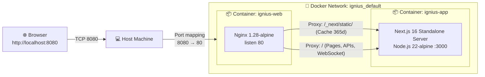

# 🐳 Docker + Nginx: Containerizing and Serving Ignius

**Project:** Ignius (Interactive Physics Learning Platform for Temperature and Heat)  
**Target Audience:** BSIT 3rd Year Students  
**Prerequisites:** Basic command line navigation (`cd`, `dir`/`ls`), HTML/CSS/JS fundamentals, basic understanding of HTTP and networking ports.  
**Tech Stack:** Next.js 16 (React 19), Node.js 22 LTS (Alpine), Nginx 1.28 Stable (Alpine), Docker Compose v2.  
**Estimated Time:** 45 minutes to 1 hour  

---

## Table of Contents

- [Overview & Architecture](#overview--architecture)
- [Conventions & Placeholders](#conventions--placeholders)
- [Part 1: Container & Reverse Proxy Fundamentals](#part-1-container--reverse-proxy-fundamentals)
- [Part 2: Prerequisites & Docker Installation](#part-2-prerequisites--docker-installation)
- [Part 3: Project Structure & File Layout](#part-3-project-structure--file-layout)
- [Part 4: Next.js Standalone Optimization](#part-4-nextjs-standalone-optimization)
- [Part 5: The Multi-Stage Dockerfile](#part-5-the-multi-stage-dockerfile)
- [Part 6: Nginx Reverse Proxy Configuration](#part-6-nginx-reverse-proxy-configuration)
- [Part 7: Multi-Container Orchestration (`docker-compose.yml`)](#part-7-multi-container-orchestration-docker-composeyml)
- [Part 8: Build and Run the Stack](#part-8-build-and-run-the-stack)
- [Part 9: Verification, Testing, and Log Inspection](#part-9-verification-testing-and-log-inspection)
- [Part 10: Lifecycle Management & Clean Up](#part-10-lifecycle-management--clean-up)
- [Part 11: Practice Challenges Solutions](#part-11-practice-challenges-solutions)
- [Part 12: Comprehensive Troubleshooting](#part-12-comprehensive-troubleshooting)
- [Part 13: Commands Cheat Sheet & Glossary](#part-13-commands-cheat-sheet--glossary)

---

## Overview & Architecture

In this deployment, you containerize the **Ignius** Next.js 16 web application and place it behind a high-performance **Nginx** reverse proxy.

### Why use Nginx in front of Next.js?
1. **Security & Network Isolation:** The Next.js Node.js application runs on internal port `3000` and is **never exposed directly** to the host or public internet. Only Nginx publishes port `8080` (or `80`/`443` in production).
2. **Static Asset Caching:** Nginx intercepts requests for `/_next/static/`, images, and stylesheets, serving cached responses immediately and offloading heavy traffic from the Node.js event loop.
3. **HTTP Hardening:** Nginx strips internal server versions (`server_tokens off;`), provides gzip compression, and handles gateway timeouts cleanly.
4. **WebSocket & Streaming Support:** Next.js relies on HTTP/1.1 connection upgrade headers for Fast Refresh, Server-Sent Events (SSE), and interactive physics simulations.

### Network Flow Diagram



### Text-Based Request Flow

```text
 ┌─────────┐   GET http://localhost:8080/    ┌──────────────────────────────────────────────┐
 │ Browser │ ──────────────────────────────► │ Host machine                                 │
 └─────────┘                                 │   0.0.0.0:8080                               │
      ▲                                      │        │  (Docker Port Forwarding)           │
      │                                      │        ▼                                     │
      │       200 OK + Next.js HTML/CSS      │   ┌────────────────────────────────────────┐ │
      └───────────────────────────────────── │   │ web container (Nginx 1.28-alpine)      │ │
                                             │   │   listen :80                           │ │
                                             │   │   proxy_pass http://app:3000           │ │
                                             │   └──────────────────┬─────────────────────┘ │
                                             │                      │ (Internal Docker DNS) │
                                             │                      ▼                       │
                                             │   ┌────────────────────────────────────────┐ │
                                             │   │ app container (Node 22 Next.js)        │ │
                                             │   │   listen :3000 (Private network)       │ │
                                             │   └────────────────────────────────────────┘ │
                                             └──────────────────────────────────────────────┘
```

---

## Conventions & Placeholders

| Convention | Description |
|---|---|
| `<ALL_CAPS_WITH_UNDERSCORES>` | A placeholder token. Replace with your actual value (e.g. `<HOST_PORT>` → `8080`). |
| 🪟 Windows | Commands specifically formatted for Windows PowerShell. |
| 🍎 macOS | Commands for macOS Terminal (zsh/bash). |
| 🐧 Linux | Commands for Linux distributions (Ubuntu, Debian, Fedora). |
| ✅ Checkpoint | Verification criteria to confirm before advancing to subsequent steps. |
| 💡 Pro Tip | Best practices used in enterprise production deployments. |

### Default Settings for Ignius

| Setting | Default Value | Purpose |
|---|---|---|
| Project Name | `ignius` | Prefix for Docker networks, volumes, and images |
| Host Port | `8080` | Port accessed in your browser (`http://localhost:8080`) |
| Web Service | `web` (`ignius-web`) | Nginx container listening on container port 80 |
| App Service | `app` (`ignius-app`) | Next.js container listening on internal port 3000 |
| Network Name | `ignius_default` | Isolated Docker bridge network with automatic service DNS |

---

## Part 1: Container & Reverse Proxy Fundamentals

### 1.1 Containers vs Virtual Machines

| Feature | Virtual Machine (VM) | Container (Docker) |
|---|---|---|
| **Virtualization Level** | Hardware (Hypervisor) | Operating System (Linux Kernel Namespaces & cgroups) |
| **Guest OS** | Full independent OS (several GBs) | Shares host Linux kernel (~150 MB image) |
| **Startup Duration** | 30 to 90 seconds | Under 1 second |
| **Memory Footprint** | Pre-allocated (e.g. 2 GB - 8 GB) | Dynamic (only consumes what process needs) |

### 1.2 Core Docker Concepts
- **Image:** An immutable, read-only template built layer-by-layer containing application code, runtime libraries, and environment metadata.
- **Layer Caching:** Docker saves the output of each build instruction. When rebuilding, Docker reuses cached layers if preceding instructions haven't changed.
- **Container:** A running instance of an image with an ephemeral writable filesystem layer on top.
- **Docker Compose:** A declarative YAML orchestrator that launches multiple interdependent containers with shared networks and volumes.

---

## Part 2: Prerequisites & Docker Installation

### 2.1 Requirements
- 64-bit OS: Windows 10/11 (with WSL 2), macOS (Apple Silicon or Intel), or Linux.
- Minimum 4 GB RAM (8 GB recommended).
- **Hardware Virtualization Enabled:** Must be enabled in BIOS/UEFI (VT-x for Intel, SVM Mode for AMD).

### 2.2 Installing Docker

#### 🪟 Windows (Docker Desktop + WSL 2)
1. Open **PowerShell as Administrator** and install WSL:
   ```powershell
   wsl --install
   ```
   *Reboot your PC if prompted.*
2. Download and run the **Docker Desktop for Windows** installer from [docker.com](https://www.docker.com/products/docker-desktop/).
3. Ensure **"Use WSL 2 instead of Hyper-V"** is checked during setup.
4. Launch Docker Desktop and verify the status bar displays **"Engine running"**.

#### 🍎 macOS (Docker Desktop)
1. Download the installer matching your architecture:
   - Apple Silicon (M1/M2/M3/M4) vs Intel.
2. Drag `Docker.app` into your Applications directory and grant required permissions.

#### 🐧 Linux (Docker Engine + Compose Plugin)
```bash
curl -fsSL https://get.docker.com -o get-docker.sh
sudo sh get-docker.sh
sudo systemctl enable --now docker
sudo usermod -aG docker $USER
```
*Log out and log back in for the group membership to take effect.*

### 2.3 Verification Commands

Open your terminal and execute:

```bash
docker version
docker compose version
docker run --rm hello-world
```

**Expected Result:** Both Client and Server engines report version `24.x+`, Docker Compose reports `v2.x+`, and the hello-world container prints `Hello from Docker!`.

---

## Part 3: Project Structure & File Layout

Below is the file layout of the containerized Ignius repository:

```text
ignius/
├── .dockerignore                 ← Excludes node_modules, .git, and secrets from build context
├── docker-compose.yml            ← Production Compose definition (Nginx + Next.js)
├── Dockerfile                    ← Multi-stage build for Next.js 16 (node:22-alpine)
├── next.config.mjs               ← Contains output: 'standalone'
├── .env                          ← Active runtime environment variables (PORT, HOST_PORT, secrets)
├── .env.example                  ← Environment template
├── nginx/
│   ├── Dockerfile                ← Builds Nginx image with custom configuration
│   └── nginx.conf                ← Production reverse proxy server block
├── app/                          ← Next.js App Router source code (pages, APIs, layout)
├── components/                   ← Reusable UI components
├── public/                       ← Next.js public assets (icons, images, logos)
└── package.json                  ← Project dependencies and scripts
```

---

## Part 4: Next.js Standalone Optimization

In standard deployments, running a Next.js application requires the entire `node_modules` directory (often 600 MB - 1.2 GB).

By adding `output: 'standalone'` to [`next.config.mjs`](file:///D:/coders/calph/ignius/next.config.mjs), Next.js automatically traces import dependencies and creates a self-contained server bundle in `.next/standalone`.

### [`next.config.mjs`](file:///D:/coders/calph/ignius/next.config.mjs)
```javascript
/** @type {import('next').NextConfig} */
const nextConfig = {
  output: 'standalone',
  allowedDevOrigins: [
    'local-origin.dev',
    '*.local-origin.dev',
    '192.168.18.12',
    '*.ngrok-free.dev',
    '*.ngrok-free.app',
  ],
  reactCompiler: true,
  reactStrictMode: true,
};

export default nextConfig;
```

**Benefits:**
- Reduces the final Docker image from over **1 GB down to ~150 MB**.
- Drastically speeds up build and deployment times.
- Minimizes the container attack surface by omitting development tools and unnecessary libraries.

---

## Part 5: The Multi-Stage Dockerfile

The [`Dockerfile`](file:///D:/coders/calph/ignius/Dockerfile) implements a 3-stage build pipeline using `node:22-alpine`.

```dockerfile
# ============================================================
# Stage 1: Install dependencies
# ============================================================
FROM node:22-alpine AS deps
RUN apk add --no-cache libc6-compat
WORKDIR /app

# Copy dependency manifests first to leverage Docker layer caching
COPY package.json package-lock.json* ./
RUN npm ci

# ============================================================
# Stage 2: Build the Next.js application
# ============================================================
FROM node:22-alpine AS builder
WORKDIR /app

COPY --from=deps /app/node_modules ./node_modules
COPY . .

ENV NEXT_TELEMETRY_DISABLED=1
ENV NODE_ENV=production

RUN npm run build

# ============================================================
# Stage 3: Production runner (minimal final image)
# ============================================================
FROM node:22-alpine AS runner
WORKDIR /app

ENV NODE_ENV=production
ENV NEXT_TELEMETRY_DISABLED=1
ENV PORT=3000
ENV HOSTNAME="0.0.0.0"

# Security best practice: run container as unprivileged user
RUN addgroup --system --gid 1001 nodejs && \
    adduser --system --uid 1001 nextjs

# Copy static assets and public directory
COPY --from=builder /app/public ./public

# Set correct permissions for Next.js prerender cache
RUN mkdir .next && chown nextjs:nodejs .next

# Leverage Next.js standalone output to produce a lightweight image
COPY --from=builder --chown=nextjs:nodejs /app/.next/standalone ./
COPY --from=builder --chown=nextjs:nodejs /app/.next/static ./.next/static

USER nextjs

EXPOSE 3000

CMD ["node", "server.js"]
```

### Key Highlights:
1. **Layer Caching:** `package.json` and `package-lock.json` are copied and installed *before* copying the application source code. If you only modify a component, Stage 1 is skipped entirely (`CACHED`).
2. **Security Hardening (`USER nextjs`):** The application runs as an unprivileged system user (`UID 1001`), preventing container-breakout vulnerabilities from gaining root privileges on the host.
3. **Execution Form:** `CMD ["node", "server.js"]` executes as PID 1, allowing the process to intercept OS termination signals (`SIGTERM`) for graceful shutdowns.

---

## Part 6: Nginx Reverse Proxy Configuration

Nginx acts as the single entry point. The configuration in [`nginx/nginx.conf`](file:///D:/coders/calph/ignius/nginx/nginx.conf) is optimized for Next.js:

```nginx
# ============================================================
# Ignius Nginx Reverse Proxy Configuration
# ============================================================

upstream app_backend {
    server app:3000;
    keepalive 32;
}

server {
    listen 80;
    server_name localhost;

    # Security: Hide Nginx version number from response headers
    server_tokens off;

    # Document root
    root /usr/share/nginx/html;
    index index.html;

    # Gzip Compression for text and asset responses
    gzip on;
    gzip_proxied any;
    gzip_comp_level 4;
    gzip_types text/plain text/css application/json application/javascript text/xml application/xml application/xml+rss text/javascript image/svg+xml;

    # Lightweight healthcheck endpoint for Docker / orchestration
    location = /healthz {
        access_log off;
        return 200 "OK\n";
        add_header Content-Type text/plain;
    }

    # Next.js static asset caching (_next/static)
    location /_next/static/ {
        proxy_pass http://app_backend;
        proxy_http_version 1.1;
        proxy_set_header Connection "";
        expires 365d;
        access_log off;
        add_header Cache-Control "public, max-age=31536000, immutable";
    }

    # Static assets caching (images, fonts, favicon)
    location ~* \.(ico|css|js|gif|jpe?g|png|svg|woff|woff2|eot|ttf|webp)$ {
        proxy_pass http://app_backend;
        proxy_http_version 1.1;
        proxy_set_header Connection "";
        expires 7d;
        add_header Cache-Control "public, max-age=604800";
    }

    # Main reverse proxy location for Next.js app and API routes
    location / {
        proxy_pass http://app_backend;
        proxy_http_version 1.1;

        # WebSocket and connection upgrade support for Next.js Fast Refresh and streaming
        proxy_set_header Upgrade $http_upgrade;
        proxy_set_header Connection "upgrade";

        # Standard proxy headers preserving client identification
        proxy_set_header Host              $host;
        proxy_set_header X-Real-IP         $remote_addr;
        proxy_set_header X-Forwarded-For   $proxy_add_x_forwarded_for;
        proxy_set_header X-Forwarded-Proto $scheme;

        # Proxy timeouts
        proxy_connect_timeout 5s;
        proxy_read_timeout    60s;
        proxy_send_timeout    60s;
    }

    # Gateway Error Pages (uses Alpine Nginx default 50x page if upstream is down)
    error_page 500 502 503 504 /50x.html;
    location = /50x.html {
        root /usr/share/nginx/html;
    }

    # Logging: in official Nginx container, these stream to stdout / stderr
    access_log /var/log/nginx/access.log;
    error_log  /var/log/nginx/error.log warn;
}
```

The Nginx container image is defined in [`nginx/Dockerfile`](file:///D:/coders/calph/ignius/nginx/Dockerfile):
```dockerfile
# Base image: official Nginx on Alpine Linux pinned to 1.28 stable line
FROM nginx:1.28-alpine

# Replace default server configuration with our custom reverse proxy configuration
COPY nginx/nginx.conf /etc/nginx/conf.d/default.conf

# Document internal container port
EXPOSE 80

# Run Nginx in foreground as PID 1
CMD ["nginx", "-g", "daemon off;"]
```

---

## Part 7: Multi-Container Orchestration (`docker-compose.yml`)

The primary Compose file ([`docker-compose.yml`](file:///D:/coders/calph/ignius/docker-compose.yml)) coordinates both services:

```yaml
name: ignius

services:
  web:
    build:
      context: .
      dockerfile: nginx/Dockerfile
    image: ignius-web:1.0
    container_name: ignius-web
    ports:
      - "${HOST_PORT:-8080}:80"
    depends_on:
      - app
    restart: unless-stopped
    healthcheck:
      test: ["CMD", "wget", "-q", "--spider", "http://127.0.0.1/healthz"]
      interval: 30s
      timeout: 5s
      retries: 3
      start_period: 5s

  app:
    build:
      context: .
      dockerfile: Dockerfile
    image: ignius-app:1.0
    container_name: ignius-app
    environment:
      - NODE_ENV=production
      - PORT=3000
      - DATABASE_URL=${DATABASE_URL:-}
      - SESSION_SECRET=${SESSION_SECRET:-}
      - GROQ_API_KEY=${GROQ_API_KEY:-}
      - GROQ_MODEL=${GROQ_MODEL:-}
    expose:
      - "3000"
    restart: unless-stopped
    healthcheck:
      test: ["CMD", "wget", "-q", "--spider", "http://127.0.0.1:3000/"]
      interval: 30s
      timeout: 5s
      retries: 3
      start_period: 20s
```

### Directive Breakdown
- `ports: - "${HOST_PORT:-8080}:80"`: Binds host port `8080` (or the value set in `.env`) to container port `80`.
- `expose: - "3000"`: Documents port 3000 for sibling containers on the same Docker bridge network. **It does not expose port 3000 to the outside host machine**.
- `depends_on: - app`: Directs Compose to initialize the `app` container prior to launching `web`.
- `healthcheck`: Regularly executes lightweight `wget` requests to confirm responsiveness.

---

## Part 8: Build and Run the Stack

Execute all commands from the project root (`ignius`):

### 8.1 Build and Start Containers
```bash
docker compose up -d --build
```

**Output:**
```text
[+] Building ...
 => [app internal] load build definition from Dockerfile
 => [app 1/12] FROM docker.io/library/node:22-alpine
 ...
 => [web 1/4] FROM docker.io/library/nginx:1.28-alpine
 ...
[+] Running 3/3
 ✔ Network ignius_default   Created
 ✔ Container ignius-app     Started
 ✔ Container ignius-web     Started
```

### 8.2 Inspect Running Containers
```bash
docker compose ps
```

**Expected Output:**
```text
NAME         IMAGE            COMMAND                  SERVICE   CREATED          STATUS                    PORTS
ignius-app   ignius-app:1.0   "docker-entrypoint.s…"   app       30 seconds ago   Up 29 seconds (healthy)   3000/tcp
ignius-web   ignius-web:1.0   "/docker-entrypoint.…"   web       30 seconds ago   Up 28 seconds (healthy)   0.0.0.0:8080->80/tcp
```

Notice:
- `ignius-web` maps `0.0.0.0:8080->80/tcp`.
- `ignius-app` shows only internal `3000/tcp` (securely shielded from the host).
- Both containers achieve `(healthy)` status.

---

## Part 9: Verification, Testing, and Log Inspection

### 9.1 Browser Verification
Open your browser and navigate to:
```text
http://localhost:8080
```
**Result:** The Ignius Interactive Physics Learning Platform loads with all pages, simulations, formulas, and navbar actions functional.

### 9.2 Inspect HTTP Response Headers
Use `curl` to verify Nginx's security and caching headers:

```bash
# In Windows PowerShell:
curl.exe -I http://localhost:8080/

# In macOS / Linux:
curl -I http://localhost:8080/
```

**Expected Output:**
```text
HTTP/1.1 200 OK
Server: nginx
Content-Type: text/html; charset=utf-8
Connection: keep-alive
...
```
*Verification Check:* `Server: nginx` has **no version number attached**, validating `server_tokens off;`.

### 9.3 Inspect Healthcheck Endpoint
```bash
curl.exe -i http://localhost:8080/healthz
```
**Expected Output:** `HTTP/1.1 200 OK` returning `OK`.

### 9.4 Inspect Real-Time Logs
```bash
# View combined logs
docker compose logs web

# Stream logs continuously while browsing
docker compose logs -f web

# Stream Next.js application logs
docker compose logs -f app
```
*(Press `Ctrl + C` to stop watching the log stream without stopping the containers).*

### 9.5 Execute Commands Inside the Running Containers
To open an interactive shell inside the containers:

```bash
# Open shell inside Next.js application container
docker compose exec app sh

# Inside the container, run:
uname -a
whoami        # Returns: nextjs (unprivileged non-root user)
exit

# Open shell inside Nginx web container
docker compose exec web sh

# Inside the container, run:
nginx -v      # Returns: nginx version: nginx/1.28.x
exit
```

---

## Part 10: Lifecycle Management & Clean Up

| Goal | Command | Description |
|---|---|---|
| **Stop Stack** | `docker compose stop` | Halts container processes while preserving container filesystems |
| **Start Stack** | `docker compose start` | Resumes stopped containers |
| **Restart Stack** | `docker compose restart` | Reboots running containers |
| **Tear Down** | `docker compose down` | Stops and removes containers and networks |
| **Full Teardown & Remove Images** | `docker compose down --rmi all` | Removes containers, networks, and custom images |
| **Inspect Disk Usage** | `docker system df` | Displays disk space used by images, containers, and build cache |
| **Prune Unused Images & Cache** | `docker system prune -a` | Cleans up all orphaned containers, networks, and unused images |

---

## Part 11: Practice Challenges Solutions

### Challenge 1: Dynamic Host Port Configuration with `.env` 🔢

Rather than hard-coding `8080`, define `HOST_PORT` in your `.env` file:

```text
HOST_PORT=9090
```

Apply the change without rebuilding:
```bash
docker compose up -d
```
The site is now live at `http://localhost:9090`. To revert, change `HOST_PORT=8080` and run `docker compose up -d`.

---

### Challenge 2: Native Next.js 404 Routing 📄

Because Nginx proxies all non-static requests to Next.js, Next.js handles routing and non-existent pages natively via `app/not-found.jsx`.

Test an invalid URL:
```bash
curl.exe -I http://localhost:8080/nonexistent-route
```
Next.js returns `HTTP/1.1 404 Not Found` and renders the styled Ignius 404 page.

---

### Challenge 3: Scaling Backend Replicas & Observing Load Balancing ⚖️

Because the `app` service is stateless and unconstrained by a fixed host port, you can scale it horizontally:

1. Launch 3 replicas of the Next.js backend:
   ```bash
   docker compose up -d --scale app=3
   ```
2. Reload Nginx DNS resolution:
   ```bash
   docker compose restart web
   ```
3. Check status:
   ```bash
   docker compose ps
   ```
   **Output:** You will see `ignius-app-1`, `ignius-app-2`, and `ignius-app-3` all running concurrently. Nginx automatically distributes incoming traffic across all three replicas using round-robin load balancing.

---

## Part 12: Comprehensive Troubleshooting

### 12.1 Host Port Already in Use (`port is already allocated`)
- **Symptom:** `Bind for 0.0.0.0:8080 failed: port is already allocated`
- **Cause:** Another service (XAMPP, Apache, another container) is occupying port 8080.
- **Solution:**
  1. Change `HOST_PORT=8081` in `.env` and rerun `docker compose up -d`.
  2. Or identify and terminate the occupying process:
     - 🪟 Windows: `netstat -ano | findstr :8080` (get PID and terminate via Task Manager).
     - 🍎 / 🐧 Unix: `sudo lsof -i :8080` or `sudo ss -ltnp | grep 8080`.

### 12.2 `502 Bad Gateway` Error
- **Symptom:** Browser shows `502 Bad Gateway`.
- **Cause:** Nginx cannot connect to `app:3000`. The Next.js container may still be building or encountered an error.
- **Solution:**
  1. Inspect the app container logs:
     ```bash
     docker compose logs --tail 50 app
     ```
  2. Check container status:
     ```bash
     docker compose ps -a
     ```
  3. Wait a few moments for the initial Next.js build compilation to complete.

### 12.3 Container Exits Immediately (`Exited (1)`)
- **Symptom:** `docker compose ps` shows `Exited (1)`.
- **Cause:** Configuration syntax error.
- **Solution:**
  Test Nginx syntax without starting the container:
  ```bash
  docker compose run --rm web nginx -t
  ```
  Look for line numbers indicating missing semicolons or typos.

### 12.4 Docker Daemon Unreachable
- **Symptom:** `Cannot connect to the Docker daemon at unix:///var/run/docker.sock`
- **Solution:**
  - 🪟 Windows / 🍎 Mac: Launch **Docker Desktop** and wait for the "Engine running" status.
  - 🐧 Linux: Run `sudo systemctl start docker`.

---

## Part 13: Commands Cheat Sheet & Glossary

### Quick Commands Reference

```bash
# Build and launch in detached mode
docker compose up -d --build

# View container status
docker compose ps

# View running logs
docker compose logs -f web
docker compose logs -f app

# Validate Nginx syntax
docker compose run --rm web nginx -t

# Execute interactive shell
docker compose exec app sh
docker compose exec web sh

# Stop all containers
docker compose stop

# Stop and delete containers and networks
docker compose down

# Rebuild without cache
docker compose build --no-cache
```

### Key Glossary Terms
- **Reverse Proxy:** An intermediary server that receives external client requests and forwards them to internal upstream backend services.
- **Multi-Stage Build:** A Dockerfile technique that utilizes temporary intermediate images (`deps`, `builder`) to compile code, copying only the final build output into a lean production image (`runner`).
- **Bridge Network:** Docker's internal software-defined network allowing containers within the same project to discover and communicate with each other using service names (e.g., `app`, `web`).
- **PID 1:** The primary root process of a container. A container lives only as long as its PID 1 process remains active.
- **Standalone Output:** Next.js feature that bundles only used dependencies, creating a lightweight, self-sufficient Node.js server.
